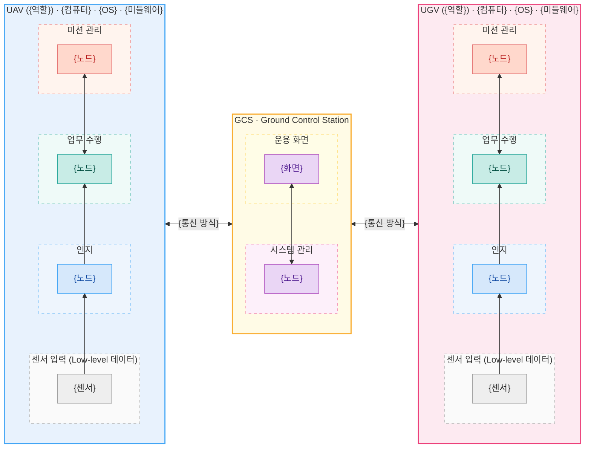
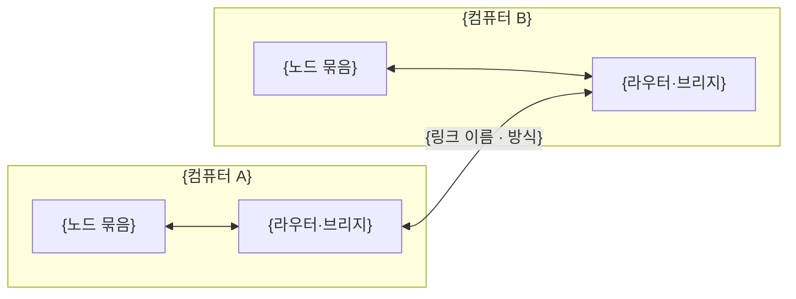
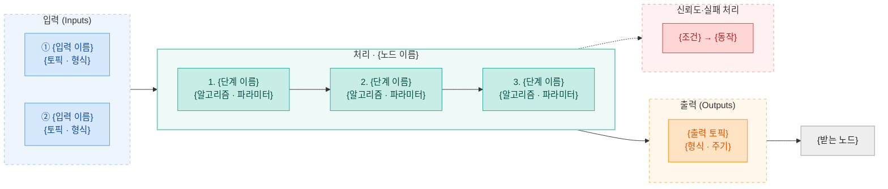
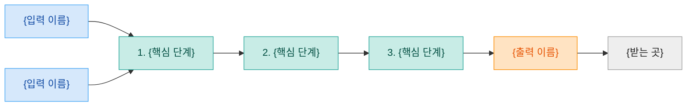
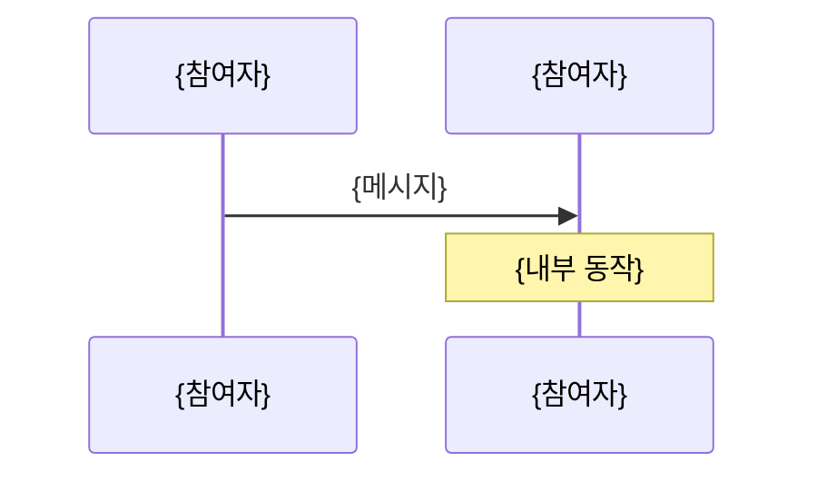

# 다이어그램 양식 (아키텍처·통신·흐름)

- 쓰는 곳: SUVLab Works의 "시스템 구조도 설계"·"시스템 설계 내용 정리", 개발 문서의 "시스템 구성". 구성요소가 나오면 **기본으로 그린다**(사용자가 "아키텍처를 많이 그려야 한다"고 요청함).
- 기본 3종: **전체 시스템 아키텍처** / **통신 아키텍처** / **임무(동작) 흐름**. 자료에 상태 기계(FSM)가 있으면 상태 다이어그램을 더한다.
- 개발 문서(기술개발계획서)는 여기에 **노드 아키텍처**(노드마다 1장)를 더한다.
- 그리는 방법은 두 가지이고, 쓸 수 있으면 둘 다 한다.
    - A. **ChatGPT 이미지**: 보기 좋은 그림. 노션에 직접 첨부한다. 전체 시스템 아키텍처에 쓴다.
    - B. **Mermaid**: 노션 안에서 그림으로 보이고 고칠 수 있다. 글자가 정확하다. 모든 다이어그램에 쓴다.

## 전체 시스템 아키텍처 형식 (사용자 지정 양식)

시스템(기체)마다 세로 칸 하나, 칸 안에 층을 위에서 아래로 쌓는다.

- 맨 위 제목: `{시스템 이름} · System Architecture ({구성})`, 그 아래 한 줄 요약: `{버전} · {OS·미들웨어} · {노드 수 등}`
- 칸(왼쪽 → 오른쪽): UAV(파랑) / GCS(노랑) / UGV(분홍). 다른 시스템이면 같은 방식으로 칸을 늘린다.
- 칸 머리: `{이름} ({역할})` + `{컴퓨터} · {OS} · {미들웨어}`
- 층(점선 상자, 위 → 아래): **미션 관리** → **업무 수행** → **인지** → **센서 입력 (Low-level 데이터)**. GCS는 **운용 화면** → **시스템 관리**.
- 노드 상자: 노드 이름, 필요하면 둘째 줄에 괄호로 짧은 역할(자료에 있을 때만).
- 화살표: 칸 안에서는 미션 관리 ↔ 업무 수행, 인지 → 업무 수행, 센서 입력 → 인지. 칸 사이에는 통신 방식 라벨(예: `Link A · Zenoh`).
- 노드를 어느 층에 둘지는 자료에 없으면 노드 이름으로 정하고 ③ 확인할 것에 "층 배치는 이름 기준 제안"이라고 적는다.

## 노드 아키텍처 형식 (기술개발계획서의 노드 개념도)

노드(모듈) 하나를 왼쪽에서 오른쪽으로 그린다.

- 왼쪽 **입력 (Inputs)**: 번호(①②③) + 입력 이름 + 토픽·형식
- 가운데 **처리**: 번호 붙은 단계 상자(1 → 2 → 3), 상자 안 둘째 줄에 알고리즘 이름·핵심 파라미터. 처리 흐름이 둘 이상(예: Keyframe / Inter-frame)이면 흐름마다 줄을 나눈다.
- 오른쪽 **출력 (Outputs)**: 토픽 + 형식 + 주기, 그 오른쪽에 받는 노드
- 아래 **신뢰도·실패 처리**: 조건 → 동작(누구에게 무엇을 알리는지)
- 입력·출력·처리 단계는 자료에 있는 것만 그린다. 없으면 그 상자를 빼고 ③에 적는다.

## A. ChatGPT 이미지

### 쓸 수 있는지 확인 (묻지 않고 확인만)

```bash
codex login status                         # "Logged in using ChatGPT" 이어야 함
codex features list | grep image_generation  # "image_generation ... true" 이어야 함
```

- 둘 다 맞으면 A를 한다. 하나라도 아니면 **A는 건너뛰고 B만** 한다(설치·로그인을 따로 묻지 않는다). ④에 "ChatGPT 로그인이 없어 Mermaid로만 그림"이라고 적는다.

### 실행

이미지 폴더: `~/notion-output/{문서 파일명}_diagrams/` (문서 파일명은 SKILL.md 규칙, 확장자 제외)

```bash
codex exec --skip-git-repo-check -C <이미지 폴더> -s workspace-write [-i <참고 그림>] -o <이미지 폴더>/codex_01_last.txt "<프롬프트>"
```

- 1–3분 걸린다. 백그라운드로 실행하고 그동안 본문을 쓴다.
- 사용자가 참고 그림 경로를 줬으면 `-i` 로 넘긴다. 없으면 아래 프롬프트의 형식 설명만 쓴다.
- 이미지 파일 이름: `01_전체_시스템_아키텍처.png` 처럼 번호 + 제목. Mermaid PNG(`mermaid_` 로 시작)와 겹치지 않게 한다.

### 프롬프트 양식 (전체 시스템 아키텍처)

```text
첨부한 참고 그림과 같은 형식·스타일로 시스템 아키텍처 이미지를 1장 생성해서, 현재 폴더에 `{파일 이름}.png` 로 저장해줘.
형식: 흰 배경, 가로 16:9, 3열 패널(왼쪽 UAV 파란 패널 / 가운데 GCS 노란 패널 / 오른쪽 UGV 분홍 패널). 각 패널 안에 점선 층 박스(층 이름은 박스 왼쪽 위), 그 안에 둥근 노드 박스, 박스 사이 화살표. 글자는 아래 텍스트를 정확히 그대로 쓰고 다른 글자는 넣지 마. 글자는 작아도 또렷하게.

제목: {제목}
부제: {한 줄 요약}

[왼쪽 패널] 헤더 "{이름}", 헤더 아래 "{컴퓨터 · OS · 미들웨어}"
- 층 "미션 관리": {노드} / {노드}
- 층 "업무 수행": {노드} / {노드}
- 층 "인지": {노드} / {노드}
- 층 "센서 입력 (Low-level 데이터)": {센서} / {센서}
(가운데·오른쪽 패널도 같은 모양으로)

화살표
- 각 패널 안: 미션 관리 ↔ 업무 수행, 인지 → 업무 수행, 센서 입력 → 인지
- {패널 사이 연결과 라벨}

이미지 파일 저장 말고 다른 파일은 만들거나 고치지 마. 끝나면 저장한 파일 경로만 한 줄로 답해줘.
```

- 참고 그림이 없으면 첫 줄을 "아래 형식으로 시스템 아키텍처 이미지를 1장 생성해서" 로 바꾼다.
- 노드 이름·라벨은 본문(Mermaid)과 **같은 글자**로 쓴다.
- 결과 이미지는 Read로 열어 글자가 틀린 곳이 있는지 확인한다. 틀린 글자가 있으면 ③에 "ChatGPT 이미지의 {틀린 글자} — Mermaid 그림이 정확함"이라고 적는다(다시 생성은 사용자가 원할 때만).

## B. Mermaid

### 규칙 (렌더링 오류·배치 깨짐을 막기 위해)

- 전체 시스템 아키텍처: 맨 위 `flowchart LR`, 시스템마다 `subgraph`, 그 안 첫 줄 `direction BT`(아래에서 위로 쌓기). 층도 `subgraph`.
- 화살표는 **아래 층 → 위 층** 방향으로 쓴다: `{아래} --> {위}`, 양방향은 `{아래} <--> {위}`. 화살표 방향이 배치를 거꾸로 만들면 방향 없는 선 `---` 에 라벨을 단다.
- `A <-- B` 는 Mermaid 문법이 아니다(렌더링 오류). 쓰지 않는다.
- 같은 층 안 노드끼리의 화살표는 층을 비뚤게 만들므로 꼭 필요할 때만 쓴다.
- 칸 안의 **연결 없는 상자들을 세로로 쌓으려면** 그 칸을 `direction LR` 로 둔다(TB면 가로로 늘어서 그림이 너무 넓어진다). 노드 아키텍처의 입력·실패 처리 칸이 이 경우다.
- 시스템 칸 사이 연결은 노드가 아니라 **subgraph끼리** 잇는다(`UAV <-->|"Link A · Zenoh"| GCS`). 칸 순서는 이 연결 순서로 정해진다(UAV → GCS → UGV 순으로 이으면 그 순서로 놓인다).
- 노드 ID는 영문·숫자(`U1`, `R1`, `G1`), 라벨은 큰따옴표 안에. 줄바꿈은 `<br/>`.
- 순서도(sequenceDiagram)에서 `;` 를 쓰지 않는다(문장 구분자로 읽힌다). 내부 동작은 `Note over` 로 쓴다.
- 색은 아래 뼈대의 `classDef` / `style` 을 그대로 쓴다.

### 검사 (파일을 쓸 수 있는 환경)

```bash
python3 <이 Skill 폴더>/scripts/render_mermaid.py <저장한 본문.md> --out <이미지 폴더>
```

- `"ok": false` 면 오류 메시지를 보고 고쳐서 다시 실행한다. 모두 `true` 가 될 때까지.
- PNG(`mermaid_01_….png`)가 저장된다. 가능하면 Read로 열어 칸 순서·층 쌓임을 눈으로 확인한다.

### 뼈대 (전체 시스템 아키텍처)

````markdown
### 전체 시스템 아키텍처

{버전} · {OS·미들웨어} · {노드 수 등 한 줄 요약}

%% 선택: ChatGPT 이미지를 만들었을 때 %%
- 📷 [그림: 전체 시스템 아키텍처 (ChatGPT 이미지) — 노션에서 직접 첨부]



### 통신 아키텍처



### 노드 아키텍처



### 간단 핵심 그림 (노션 정리 페이지용)

노션 정리 페이지의 부분별 핵심 그림은 이름만 쓰는 간단한 모양으로 그린다(형식·주기·파라미터·수식 없음). 입력은 칸 없이 모아서 첫 단계로 잇는다(`I1 & I2 --> P1`, 세로로 쌓인다).



### 임무 흐름


````

## 출력에 넣는 것

- 본문: 위 뼈대대로 다이어그램마다 `###` 제목 + Mermaid. 전체 시스템 아키텍처에는 ChatGPT 이미지 📷 자리(만들었을 때만).
- ③ 확인할 것: 층 배치·연결이 자료에 없어 Claude가 정한 부분, ChatGPT 이미지의 틀린 글자.
- ④ 따로 할 일: 노션에 첨부할 이미지 경로(ChatGPT 이미지, 필요하면 `mermaid_*.png`).
