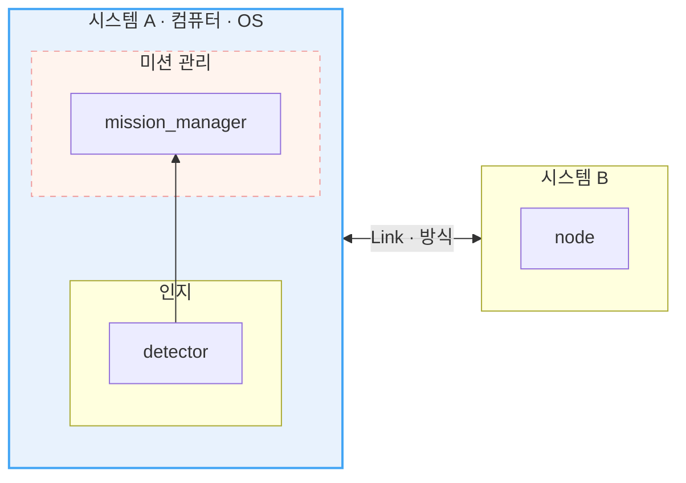
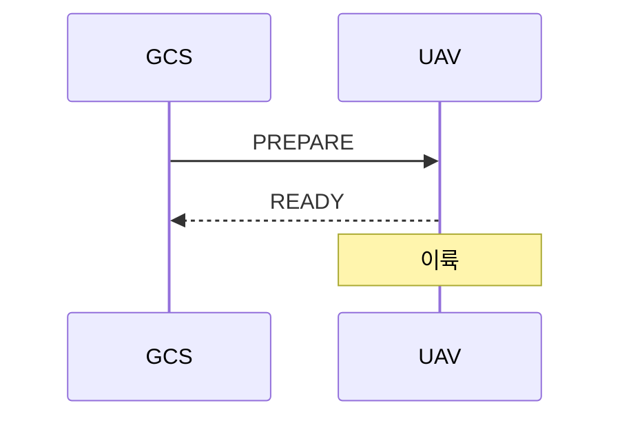

# 노션 붙여넣기 테스트 (H1)

이 파일 전체를 복사해서 노션 빈 페이지에 붙여넣고, 각 줄이 설명대로 바뀌는지 확인한다.
문단 안의 **굵게**, *기울임*, `인라인 코드`, [링크](https://www.notion.so) 가 서식으로 보이면 정상.

## 제목 2 (H2)

### 제목 3 (H3)

## 목록

- 글머리 기호 1단계
    - 2단계 (공백 4칸 들여쓰기)
        - 3단계 (공백 8칸 들여쓰기)
- 글머리 기호 아래 들여쓴 문단
    
    이 문단은 위 글머리 기호의 하위 블록으로 들어가야 정상
    
1. 번호 목록 1
2. **굵은 단계명**: 번호 목록 2
    - 번호 목록 아래 글머리 기호

## 체크박스

- [ ] 체크 안 된 할 일 — 담당자 — 기한
- [x] 체크된 할 일

## 표

| 할당 과제 | 품목 | 수량 | 단가 | 총 금액 | 구매 링크 |
|---|---|---|---|---|---|
| 과제A | 테스트 품목 | 2 | ₩12,900 | ₩25,800 | https://www.example.com/product?id=1&q=test |
| 과제B | 품목 / 옵션 | 1 | ₩0 | ₩0 | ⚠️ 확인 필요 |

## 인용

> 인용 블록으로 바뀌어야 정상 (p. 3)

## 코드 블록

```bash
ros2 topic echo /example/topic
```

## Mermaid (구조도용 — 노션에서 다이어그램으로 보이는지 확인)


## Mermaid 층 구조 (subgraph · 색) — 칸 안에 층 상자가 쌓여 보이면 정상



## Mermaid 순서도 (sequenceDiagram)



## 자리 표시

- 📷 [그림: 그림 자리 표시 — 노션에서 직접 첨부]
- 📎 [파일: 파일 자리 표시 — 노션에서 직접 첨부]
- 🎞 [영상: 영상 자리 표시 — 노션에서 직접 첨부]
- 값 확인 필요 표시: ⚠️ 확인 필요

---

위 가로줄이 구분선으로 바뀌면 정상. 끝.
